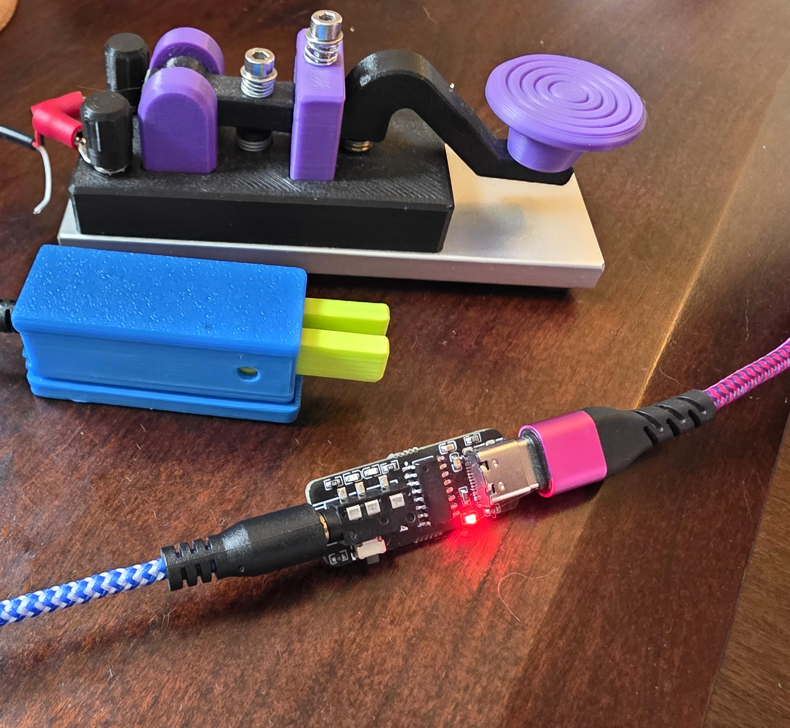

This code was created to provide an alternative firmware to the aliexpress "CW Key Trainer Adapter Type-C USB Vband Morse Code Training for Computer Connector MorseLink Amateur HAM Radio Telegraph" device.

This name was chosen because the device identifies itself on USB as a "morselink" when you go to reflash it.

I'm not affiliated with aliexpress or the creator of this device.  I just worked out what pins were connected where on the CH552G chip and wrote this very basic code to make it generate a proper left and right control key when the iambic paddles are pressed.
This works for me with https://hamradio.solutions/vband/

I'm not affiliated with Hamradio Solutions either.  You'd be better off using the Store link on their website to buy the official device.  I already had the aliexpress clone so I figured it was better to reflash it than to create e-waste.

no warranty or support implied with this code.  use at your own risk.
